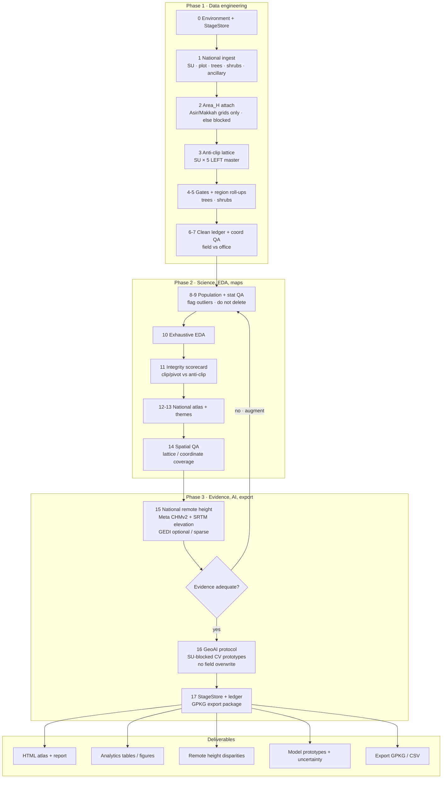

# Latest workable scientific methodological workflow (national)

Companion to the plate:
`outputs_national_v5/documents/NFI_National_Methodological_Workflow_Latest.jpg`

Scope: **entire Kingdom** (`asir_only: false`). Frame: 3671 SUs, 18355 anti-clip plot slots, 13 regions.

## Hard rules (current implementation)

1. Anti-clip: never inner-join the SU universe to trees only.
2. Imputation OFF for remote products overwriting field measurements.
3. Biomass / carbon remain **provisional sample metrics**.
4. National remote height evidence uses wall-to-wall Meta CHMv2 + SRTM elevation (3,671 SUs); GEDI is not required for adequacy.
5. Design-based national totals stay blocked until weights and full Area_H exist.

## Entry points

- Full national run: `python run_national_pipeline.py`
- Workflow refresh: `python run_workflow_e2e.py`
- Remote height: `python run_national_remote_height.py`
